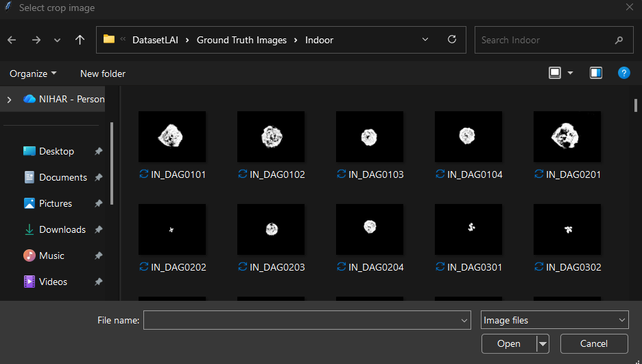
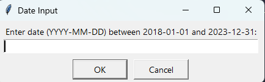
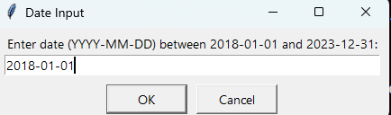
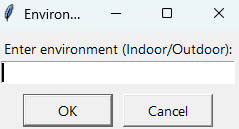
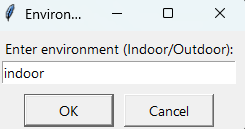
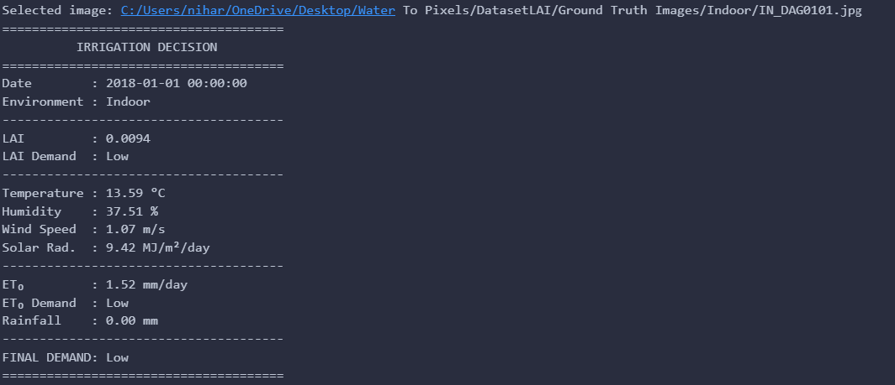

# Pixels to Water

Pixels to Water is a research project exploring how crop images and environmental data can support crop monitoring and irrigation decision support. The repository contains two connected but separately evaluated workstreams:

1. **Sorghum cultivar classification** — classify field images into one of 100 sorghum cultivars.
2. **Lettuce LAI estimation and irrigation decision support** — estimate Leaf Area Index (LAI) from RGB images, then combine LAI with reference weather in a rule-based demand indicator.

These are research prototypes, not a single integrated application. Their datasets, labels, and results are different and should not be compared directly.

## 1. Sorghum cultivar classification

### Dataset preparation

The experiment used a balanced local subset of 5,000 field images from the Sorghum-100 Cultivar Identification dataset. It contains 100 cultivar classes, with 50 images per cultivar. The source mapping listed 22,194 image rows; validation confirmed that the 5,000 locally available images each had one valid cultivar label. One invalid `.DS_Store` row was excluded.

The data was split by cultivar into:

| Split | Images | Share |
| --- | ---: | ---: |
| Train | 4,000 | 80% |
| Validation | 500 | 10% |
| Test | 500 | 10% |

The split uses random seed 42. Manifests and validation summaries are recorded in `results/`.

### Image pipeline and models

The notebooks compare ImageNet-pretrained **ResNet-18** and **EfficientNet-B0** for 100-class classification. Images are processed at 224 × 224 pixels and normalized with ImageNet channel statistics. Training uses random resized crops, small rotations, horizontal flips, and color jitter. Validation and test preprocessing is deterministic.

The current training configuration uses a batch size of 32, AdamW, learning rate `0.0001`, weight decay `0.0001`, and a maximum of 20 epochs. The saved checkpoints select the best validation epoch. Refer to each notebook and its JSON metadata for the exact run details.

### Test results

| Model | Accuracy | Precision | Recall | Macro F1 | Top-5 accuracy |
| --- | ---: | ---: | ---: | ---: | ---: |
| ResNet-18 | 0.686 | 0.725 | 0.686 | 0.679 | 0.904 |
| EfficientNet-B0 | 0.742 | 0.779 | 0.742 | 0.738 | 0.928 |

EfficientNet-B0 is the selected candidate because it scored higher on these aggregate test metrics and had fewer recorded test errors. A paired McNemar significance test was not calculated: aligned per-image predictions for both models are not available. The test set has only five images per cultivar, so per-class scores can vary substantially. This result does not establish that EfficientNet-B0 will be better on other datasets.

## 2. Lettuce LAI estimation

This workstream uses image and numerical measurements from a lettuce RGB-LAI dataset. The clean split contains 336 samples:

| Split | Samples |
| --- | ---: |
| Train | 234 |
| Validation | 51 |
| Test | 51 |

The split validation found no missing image paths, invalid targets, duplicate paths across splits, or identical image hashes across splits. Data preparation and model comparison are documented in notebooks 16–21.

### Models and clean test results

The **Random Forest baseline** predicts LAI from nine RGB summary features computed from each image: mean and standard deviation for red, green, and blue, mean brightness, green-to-red ratio, and green-to-blue ratio.

| Model | Test MAE | Test RMSE | Test R² |
| --- | ---: | ---: | ---: |
| Random Forest with RGB features | 0.0062 | 0.0098 | 0.866 |
| ResNet-18 image regression | 0.0968 | 0.1206 | -19.543 |
| EfficientNet-B0 image regression | 0.0741 | 0.0879 | -9.927 |

On this small split, the feature-based baseline performed better than the evaluated image-regression models. The negative R² values mean those CNN regressors performed worse on this test set than predicting its mean LAI. These results are specific to this dataset, split, and training setup; they do not show that CNNs are generally unsuitable for LAI estimation.

The Random Forest artifact used by the copied decision-engine notebook is `workspace/DatasetLAI/lai_rf_model.joblib`. The PyTorch checkpoints for the clean-split regression experiments are in `models/`.

## 3. Irrigation decision-support prototype

The repository demonstrates the pieces of a decision-support workflow, but does not provide a packaged or field-ready application. The image model estimates LAI; a separate rule-based component uses LAI, growing environment, reference evapotranspiration (ET₀), and rainfall to report a relative demand class.

### Inputs and rules

- **Image and environment:** an Indoor or Outdoor lettuce image is summarized into the nine RGB features above; the Random Forest estimates LAI.
- **LAI class:** LAI is compared with environment-specific 33rd and 66th percentile thresholds from the reference dataset.
- **ET₀ class:** ET₀ is compared with 2.2311 and 5.1584 mm/day, the 33rd and 66th percentiles of the reference weather series.
- **Demand fusion:** use the higher of the LAI and ET₀ demand levels (`LOW < MODERATE < HIGH`).
- **Rain adjustment:** if rainfall is at least 2.7575 mm/day, reduce the combined level by one class, with `LOW` remaining `LOW`.

The LAI thresholds are:

| Environment | Low / Moderate boundary | Moderate / High boundary |
| --- | ---: | ---: |
| Indoor | 0.03198 | 0.05981 |
| Outdoor | 0.00324 | 0.00722 |

The ET₀ workflow uses the FAO-56 Penman–Monteith equation. Its weather values are reference data from NASA POWER for Central California (36.5°N, 119.5°W, 2018–2023); they are not measurements from the lettuce image experiment. The thresholds are dataset-derived heuristics, not universal crop-water thresholds.

The output is `LOW`, `MODERATE`, or `HIGH` demand plus an explanation of the rules applied. **It does not calculate an irrigation depth**, and it has not been validated against field irrigation outcomes. More detail is in [`docs/irrigation_decision_engine.md`](docs/irrigation_decision_engine.md).

### Tkinter prototype walkthrough

The screenshots below show the current desktop workflow in sequence: choose an image, enter a date, specify whether the image is Indoor or Outdoor, and review the resulting irrigation-demand summary. The result shown is one example from the prototype; it is not a field-validated recommendation.

1. **Select a crop image.** Choose an image from the file picker.

   

2. **Enter the date.** The prompt accepts dates from `2018-01-01` through `2023-12-31` in `YYYY-MM-DD` format.

   

   

3. **Choose the growing environment.** Enter `Indoor` or `Outdoor`.

   

   

4. **Review the decision summary.** The example displays the selected image, date, environment, estimated LAI and LAI demand, weather values, ET₀ demand, rainfall, and final demand class.

   

## Repository guide

| Path | Contents |
| --- | --- |
| `notebooks/01`–`15` | Sorghum data validation, splitting, preprocessing, training, evaluation, comparison, and error analysis |
| `notebooks/16`–`21` | Lettuce LAI dataset preparation, baselines, CNN regression, comparison, and error analysis |
| `notebooks/22_engine.ipynb` | LAI / ET₀ / rainfall decision rules |
| `notebooks/Weather_ET0.ipynb` | Reference weather preparation and ET₀ calculation |
| `src/` | Sorghum dataset, preprocessing, training, evaluation, and manifest utilities |
| `models/` | Trained PyTorch checkpoints |
| `workspace/DatasetLAI/` | Random Forest model, image-to-LAI decision-engine notebook, and MATLAB helper scripts |
| `results/` | Split manifests, model metrics, prediction summaries, and plots |
| `reports/experiments.md` | Experiment history and validation details |
| `docs/irrigation_decision_engine.md` | Decision-rule definitions and limitations |
| `configs/preprocessing.yaml` | Preprocessing configuration |

## Data required to reproduce the work

The source datasets and generated LAI split files are not included in GitHub. Do not assume a fresh clone has the data needed to run the notebooks.

### Sorghum

The training script expects the Sorghum images in a `Dataset/` directory beside the repository, for example:

```text
parent-folder/
├── Dataset/
│   ├── *.png
│   ├── train_cultivar_mapping.csv
│   ├── germplasm.csv
│   └── season_6_aboveground_fresh_biomass_manual.csv
└── pixels-to-water/
```

Use the original data provider's files and terms. The notebooks and scripts also rely on the generated manifests stored under `results/`.

### Lettuce LAI

Notebook 16 looks for a `DatasetLAI/` directory beside the repository (or inside it) with the original `Numerical Data/` workbook and `Raw Images/` tree. Running it validates the image references and creates `data/lai_dataset.csv`, `data/lai_train.csv`, `data/lai_val.csv`, `data/lai_test.csv`, and the clean-split counterparts. These files are intentionally untracked. Notebooks 17–21 require the appropriate CSV splits and source images.

The copied image-to-LAI notebook in `workspace/DatasetLAI/` loads `lai_rf_model.joblib` from its working directory and expects `weather_eto.csv` plus an input image. The weather CSV and source image are not included. Notebook 22 also reads the source measurement workbook; check its first cells for the expected working-directory path before running it.

For the weather exploration notebook, the source NASA POWER CSVs are expected under `ds/USA/` (`T2M.csv`, `RH2M.csv`, `WS2M.csv`, `ALLSKY_SFC_SW_DWN.csv`, and `PRECTOTCORR.csv`). They are not included in the repository.

See [`data/README.md`](data/README.md) for the data storage policy and [`workspace/README.md`](workspace/README.md) for the copied decision-engine assets.

## Setup

From the repository root, create an environment and install the project dependencies:

```bash
python -m venv .venv
# Activate .venv using the command for your operating system
python -m pip install --upgrade pip
pip install -r requirements.txt
jupyter lab
```

PyTorch installation can depend on the available operating system and accelerator. If the default dependency install is unsuitable for your machine, install the compatible PyTorch and torchvision builds first, then install the remaining requirements.

Open notebooks from the repository root unless a notebook explicitly expects another working directory. Provide the datasets listed above before executing data-dependent cells. Existing notebook outputs and result files are included for review; rerunning cells can overwrite generated outputs.

## Current scope and limitations

Completed work includes Sorghum subset validation, balanced splits, classifier training and comparison, clean lettuce LAI splits, feature-based and image-based regression experiments, and rule-based demand classification. A unified application, real-time data ingestion, calibrated irrigation-depth calculation, and field validation have not been implemented.

The classification and LAI experiments use different crops, datasets, and targets. The LAI evaluation set is small, the sorghum test set has five samples per class, the irrigation cutoffs are empirical, and the reference weather does not represent the lettuce experiment site. Treat the results as exploratory evidence, not operational agronomic recommendations.
